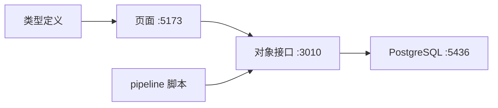

# Palantir Ontology Study

用一套能点开的页面，学 Palantir 的 Ontology 怎么装下一件具体的事。这件事是沪深 A 股的开盘安排：明天买什么、卖什么、还是空仓。

一条命令就能看到这一版做法，名字叫 **涨停回马枪 1**：

```bash
./demo.sh
```

需要 Node.js 20、npm、Docker。脚本会起数据库、接口和页面，并写入演示账户、这一版做法、2026-10-15 的一页开盘安排。



点图上的一个词，只出现一句人话。走查写在 [`docs/走查.md`](docs/走查.md)。

在线页面（只有前端，对象要本机接口才有数）：https://andersonwu2008.github.io/PalantirOntologyStudy/

## 目录

- [它解决什么](#它解决什么)
- [你会看到什么](#你会看到什么)
- [快速开始](#快速开始)
- [使用指南](#使用指南)
- [仓库里各放什么](#仓库里各放什么)
- [建议的阅读顺序](#建议的阅读顺序)
- [这个仓库不包含什么](#这个仓库不包含什么)
- [许可证](#许可证)

## 它解决什么

Ontology 是给一个领域用的类型模型：有哪些东西可以单独点开，它们之间怎么连，谁来算，谁来改。

这里的领域是 **StockTrading**。一只股票、一个交易日、一条日行情、一版做法、一页开盘安排，各是一种对象。改一版做法上的数，会新写一只对象；已经写下的开盘安排还指着当时那一版。

当前这一版做法叫 **涨停回马枪 1**。最近几年年化 23.02%，回撤 12.13%，Calmar 1.90。选股也在这一套里：只从四百多只股票池里挑，不是全市场。袖套上的数钉在这只对象上。挑选顺序在 [`pipeline/functions/huimaqiang.ts`](pipeline/functions/huimaqiang.ts)。

## 你会看到什么

| 想看的 | 打开 |
| --- | --- |
| 课程 | http://localhost:5173/course |
| 全部对象类型 | http://localhost:5173/ontology |
| 涨停回马枪 1 | http://localhost:5173/ontology/object-view?type=Strategy&id=v46-huimaqiang |
| 回马枪怎么挑股票 | http://localhost:5173/ontology/manager?section=function&type=computeHuimaqiangFactors&kind=function |
| 明早那一页 | http://localhost:5173/workshop/pre-open?date=2026-10-15 |

点图上的一个词，只出现一句人话。第二句收在「再看一句」里。

## 快速开始

需要本机已安装：

- Node.js 20 或更新
- npm
- Docker（用来起 PostgreSQL）

克隆之后，在仓库根目录执行：

```bash
chmod +x demo.sh
./demo.sh
```

想自己看每个进程，再按下面三步开。

**1. 数据库**

```bash
docker compose up -d
```

Postgres 16 监听 `localhost:5436`，库名 `stock_ontology`，用户 `ontology`，密码 `ontology_dev`。这是本地学习用的口令。第一次启动会执行 [`database-api/sql/001_schema.sql`](database-api/sql/001_schema.sql)，只建表，不灌行情。

**2. 对象接口**

```bash
cd database-api
npm install
npm start
```

接口在 http://127.0.0.1:3010 。确认它活着：

```bash
curl -s http://127.0.0.1:3010/schema
```

能返回 JSON，里面有 `objectTypes`，就可以开页面。

**3. 页面**

```bash
cd frontend
npm install
npm run dev
```

浏览器打开 http://localhost:5173/login 。

本地 `npm run dev` 时，登录框已经填好：

| 字段 | 值 |
| --- | --- |
| 邮箱 | `admin@example.com` |
| 密码 | `admin123` |

点登录。这组账号只在开发模式里生效，用来进页面，没有接生产登录服务。

## 使用指南

按这个顺序看。每一步只做一件事。

### 1. 先看类型，不看行情

打开 http://localhost:5173/ontology 。

左边是类型树。点 **做法**（API 名 `Strategy`）、**开盘安排**（`PreOpenArrangement`）、**股票**（`Stock`）。右边能看到这个类型有哪些属性、和谁相连。

类型定义的原文在 [`ontology/v44/`](ontology/v44/)。页面上的中文名来自这里，也来自接口的 `/schema`。

### 2. 看一版钉死的数

`./demo.sh` 写好之后，打开：

http://localhost:5173/ontology/object-view?type=Strategy&id=v46-huimaqiang

图上是这一版的袖套：牛市、高波动、震荡、熊市、价带、门、计算包。点 **牛市**，会看到这一套止盈、回落、天数、只数和仓位。点 **计算包**，会跳到选股函数。

对象列表在 http://localhost:5173/ontology?focus=Strategy 。点中 **涨停回马枪 1** 那一行，同一张图会出现在表格上方。

空库时这里没有这一行。类型页看得到「做法」，对象页要等数据写进来。见下面「把对象写进库」。

### 3. 看函数怎么挑

打开：

http://localhost:5173/ontology/manager?section=function&type=computeHuimaqiangFactors&kind=function

这条函数页上方是回马枪的挑选顺序：涨停过、回落一截、量缩了、够 5 只才打分、门开才买。点中当前函数对应的那一步，图上会亮。

同一包里这四个函数：

| 函数 | 这一步在问什么 |
| --- | --- |
| `computeHuimaqiangFactors` | 近端有没有涨停，回落是否落在区间里 |
| `computeHuimaqiangScore` | 缩量之后够不够 5 只，够了才打分 |
| `selectHuimaqiangBuys` | 门开着才买，只数和名次读做法对象 |
| `judgeHuimaqiangExits` | 卖出时读买进那天那一套止盈和天数 |

实现在 [`pipeline/functions/huimaqiang.ts`](pipeline/functions/huimaqiang.ts)。书面公式留在作者本机的 `docs/001_推导/`，没有放进这个仓库。

### 4. 看明早那一页

打开 http://localhost:5173/workshop/pre-open 。

这一页是一次开盘安排：属于哪个账户、哪个交易日、用的哪一版做法，以及两行计划（买、卖）。库里还没有安排时，页面是空的。安排由收盘管道写下，开盘管道再补涨停价和跌停价。

人确认之后才写委托。提交走动作服务，默认端口 `3020`：

```bash
npx tsx pipeline/action-server.ts
```

动作定义在 [`pipeline/actions.ts`](pipeline/actions.ts)：`ConfirmSells`、`ConfirmBuys`、`ReportFill`。

### 5. 把对象写进库

`docker compose up` 只建表。行情文件不在这个仓库里。

[`pipeline/sync-pool.ts`](pipeline/sync-pool.ts) 读取本机的 `/tmp/pool-stocks.json` 和 `/tmp/pool-bars.jsonl`，把股票和日行情写进接口。这两个文件要自己准备。

库里已经有上一版做法时，可以用下面的命令再写涨停回马枪 1。演示不走这条，`./demo.sh` 会直接写入这一版。

```bash
npx tsx pipeline/publish-v46-strategy.ts
```

其他脚本都在 [`pipeline/`](pipeline/)，通过环境变量 `DATABASE_API`（默认 `http://localhost:3010`）访问对象接口。

### 6. 常用地址

| 服务 | 地址 |
| --- | --- |
| 页面 | http://localhost:5173 |
| 对象接口 | http://127.0.0.1:3010 |
| 动作服务 | http://127.0.0.1:3020 |
| Postgres | `localhost:5436`，库 `stock_ontology` |

接口换地址时，页面用 `VITE_API_BASE_URL`，脚本用 `DATABASE_API`，数据库连接用 `DATABASE_URL`。不设的话，就用上面这组本地默认值。

## 仓库里各放什么

```text
ontology/v44/          对象类型、链接、值类型、logic.json
database-api/          唯一访问 PostgreSQL 的 HTTP 接口，端口 3010
frontend/              课程页和 Foundry 风格的各个页面，端口 5173
pipeline/              收盘、开盘、同步、回马枪函数、动作
docs/走查.md           十分钟看完涨停回马枪 1
docs/000_Overview/     从「明天要提交什么」往回推
docs/000_Stock_Object_Type/   A 股类型目录
CONTEXT.md             Palantir 词和这个领域里的词
demo.sh                一键起演示
docker-compose.yml     本地 Postgres
```

对象类型包括：Account、Stock、Industry、TradableRange、Strategy、TradingDay、DailyBar、Position、Fill、Signal、PreOpenArrangement、SellLine、BuyLine、SellOrder、BuyOrder、EvaluationRun。目录在 [`ontology/v44/index.json`](ontology/v44/index.json)。

## 建议的阅读顺序

1. [`docs/走查.md`](docs/走查.md) — 跑 `./demo.sh` 之后点哪四页。
2. [`CONTEXT.md`](CONTEXT.md) — 这些英文词在这里指什么。
3. [`docs/000_Overview/README.md`](docs/000_Overview/README.md) — 从明天要交的动作，推回要先有哪些对象。
4. [`docs/000_Stock_Object_Type/README.md`](docs/000_Stock_Object_Type/README.md) — A 股这一组类型的清单。

课程页把同一条线索收成可以点的章节：http://localhost:5173/course 。

## 这个仓库不包含什么

- 不做美股、港股，也不做 GICS。股票池按文档里的沪深 A 股来设计。
- 分钟线和逐笔不在这一版。
- `local/`、`OntologyAnalysis/`、`old/` 留在作者机器上，没有放进仓库。`docs/000_Guideline/`、`docs/001_推导/`、`docs/design/` 也留在本机。回测金样和行情大文件也没有放进来。
- 引用 Palantir、Foundry 的名字，是为了对照学习这些概念，本仓库不是 Palantir 的产品。

## 许可证

本仓库采用 [MIT License](LICENSE)。版权人是 AndersonWu2008。
